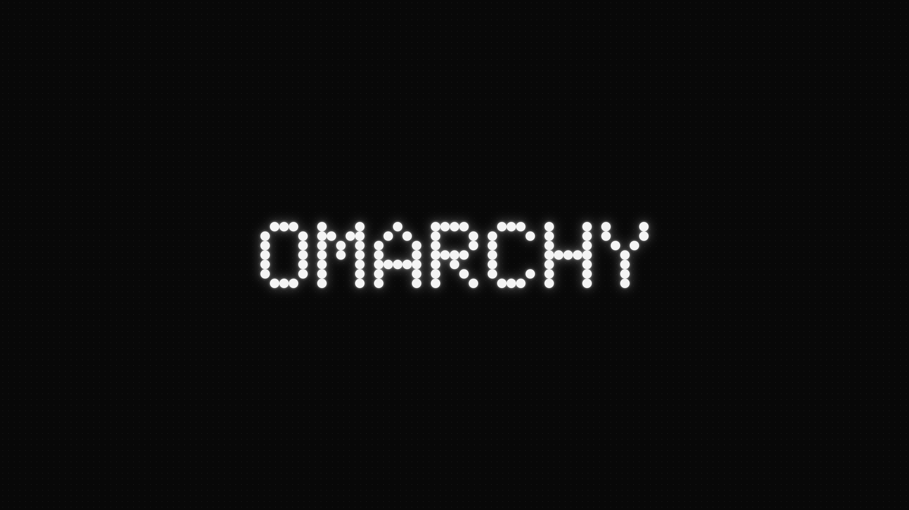

# Nothing Dark for Omarchy

A Nothing-inspired Omarchy theme: smoked glass, graphite frames, silver text, and restrained brand-red accents.



*Wallpaper preview, not a desktop screenshot. Resolution: 3840 × 2160.*

## Design

Inspired by official imagery of [Ear (3a)](https://nothing.tech/products/ear-3a), [Headphone (1)](https://nothing.tech/products/headphone-1), [Headphone (1) Pro](https://nothing.tech/products/headphone-1-pro), and [Phone (4a) Pro](https://nothing.tech/products/phone-4a-pro).

The neutrals are desktop adaptations of those materials, not official manufacturing color codes or claimed exact image samples.

| Role | Color |
| --- | --- |
| Background | `#1C1C1C` |
| Deeper / deepest surface | `#161616` / `#101010` |
| Raised surface | `#282828` |
| Foreground | `#C6C6C6` |
| Brand and interaction accent | `#D71921` |
| Active / inactive window border | `#747474` / `#414141` |

- Black, white, and grey carry the interface. Other ANSI color slots map to neutrals.
- Red marks interactions and status; active window borders stay grey.
- Menu selections use solid red with white text; launcher selections use a subtle red tint.
- The wallpaper uses Nothing's **Ndot 57** lettering, white glow, a deep-black background, and a fine dot matrix, without red decoration.
- Wallpaper colors are independent of application surfaces. Grid spacing is a design interpretation, not an exact website CSS token.

## Install

For recent Omarchy releases using `colors.toml` and Omarchy Shell:

```sh
omarchy theme install https://github.com/xvvhang/omarchy-nothing-dark-theme
```

Switch later through the theme menu or run:

```sh
omarchy theme set nothing-dark
```

**Back up an existing theme first:** Omarchy's installer may replace `~/.config/omarchy/themes/nothing-dark/`. GTK overrides are not installed automatically.

## Translucency and blur

`shell.toml` provides gently translucent surfaces. Values below are **opacity**, not transparency:

| Surface | Opacity |
| --- | --- |
| Bar | 90% |
| Popups, menu, launcher | 92% |
| Notifications, authentication dialog | 94% |
| Tooltips, lock input | 96% |

The optional `hyprland.lua` is self-contained, with no local paths or external Lua module dependencies:

- Blur size 6, two passes; blur for selected shell layers and bar popups.
- Terminal opacity: 96% active / 93% inactive.
- File manager opacity: 97% active / 95% inactive.
- Browsers, video, and fullscreen content remain opaque. Omarchy's default app opt-outs are preserved.
- Secure lock surfaces are not promised layer blur; the input remains nearly opaque.

### Optional: enable Lua material rules after review

Recent Omarchy releases **ignore Lua files in Git-installed themes** for security and generate Hyprland configuration from the palette instead. Standard installation provides the colors, grey window borders, shell translucency, and wallpaper, but does not automatically enable the custom blur or application-opacity rules.

To enable the full material treatment, review `hyprland.lua` and export a trusted local copy. Only run this after reviewing the code, and use a new destination directory:

```sh
git clone https://github.com/xvvhang/omarchy-nothing-dark-theme.git
cd omarchy-nothing-dark-theme
# Review hyprland.lua before continuing.
mkdir ~/.config/omarchy/themes/nothing-dark-local
git archive HEAD | tar -x -C ~/.config/omarchy/themes/nothing-dark-local
omarchy theme set nothing-dark-local
hyprctl reload
hyprctl configerrors
```

The exported directory has no `.git` metadata and is treated as your own local theme. Material rules are loaded only while that theme is selected. The Lua rules target Hyprland 0.56; check compatibility on other versions.

## Optional: GTK red accents

```sh
gsettings set org.gnome.desktop.interface accent-color red
```

For the exact `#D71921`, review and merge `extras/gtk-3.0.css` and `extras/gtk-4.0.css` into the corresponding `~/.config/gtk-3.0/gtk.css` and `~/.config/gtk-4.0/gtk.css` files. **Do not overwrite existing customizations.** Some applications need to be reopened. GTK overrides are global, persist across theme changes, and may not be honored by every application.

`icons.theme` selects `Yaru-red`, which must already be installed on your system.

## Typography and attribution

The wallpaper was rendered locally using the Ndot-Bold webfont referenced by [Nothing's official website CSS](https://cdn.shopify.com/oxygen-v2/43495/38485/80939/4785039/assets/Bu_XLf0T.css). Its font metadata identifies it as **Ndot 57**. No font software is bundled or installed system-wide.

This is an unofficial, independently created theme, not affiliated with or endorsed by Nothing or Omarchy. Nothing's name, fonts, and related brand rights belong to their respective owners.

By [Alec Xu / @xvvhang](https://github.com/xvvhang). Companion theme: [Nothing Light](https://github.com/xvvhang/omarchy-nothing-light-theme).
